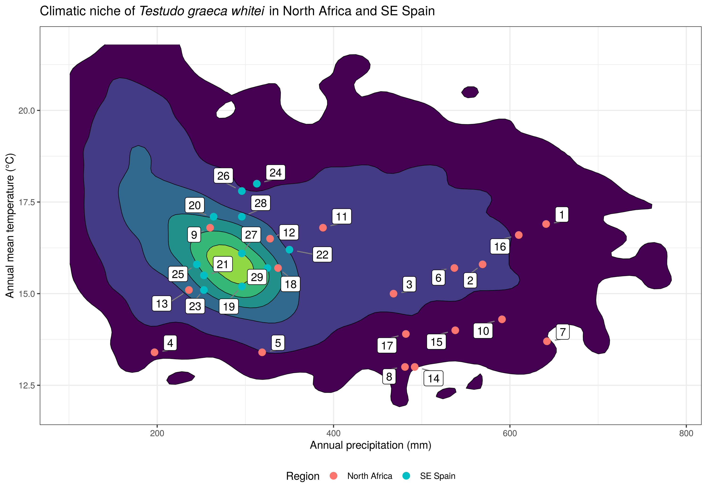
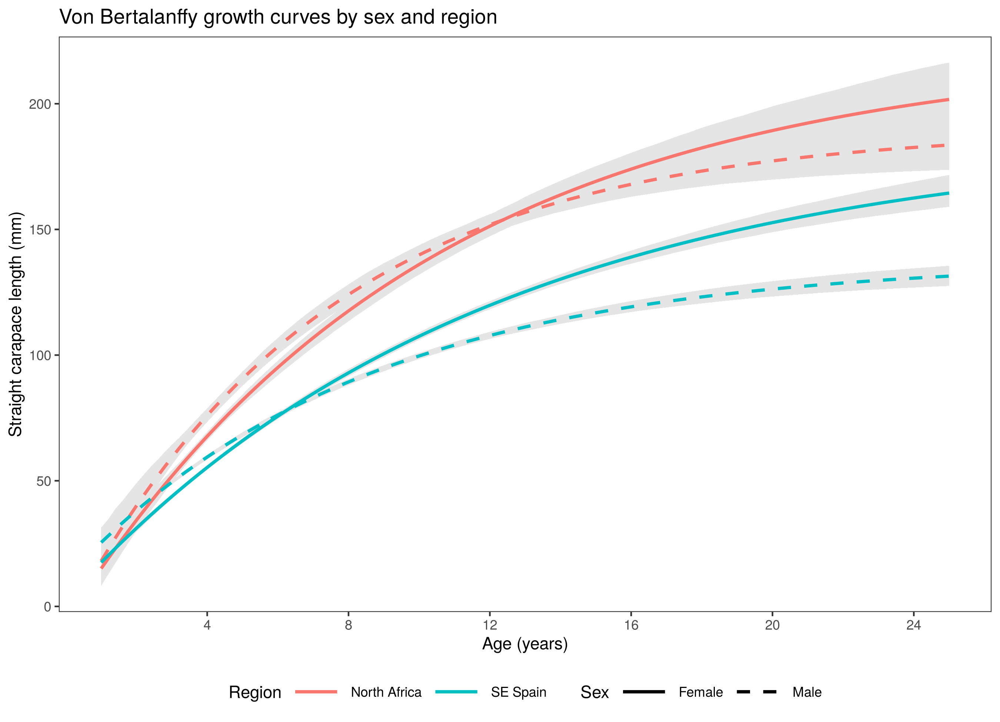

# Body size variation in *Testudo graeca whitei*

R code for the analyses and figures in:

> Semaha MJ, Rodríguez-Caro RC, Fahd S, Mira-Jover A, Giménez A, Graciá E (2024). Body size variation in a lineage of spur-thighed tortoises (*Testudo graeca whitei*) contrasts with that expected from the species level. *Amphibia-Reptilia*. https://doi.org/10.1163/15685381-bja10171

The paper is open access (CC BY 4.0).

## About the study

We measured 727 spur-thighed tortoises at 29 sites in North Africa and SE Spain to test whether body size in this lineage follows Bergmann's and Rensch's rules. It does not: body size decreases with latitude in both regions, and sexual size dimorphism is unrelated to body size.

## What is in this repository

| Script | What it does | In the paper |
|---|---|---|
| `R/00_simulate_example_data.R` | Creates the simulated example data | – |
| `R/01_climate_niche_figure.R` | 2D density plot of the climate conditions within the range of the lineage, with the sampled sites on top | Figure 2 |
| `R/02_growth_von_bertalanffy.R` | Von Bertalanffy growth models by sex and region, with bootstrap confidence intervals | Figure 5 and the growth parameters |

More scripts are on the way: body size models, sexual size dimorphism, and the climate and geography models.

## Example output

Everything in `figures/` and `tables/` was made with the simulated example data, so it shows the method and not the published results.

**Climatic niche** (`01_climate_niche_figure.R`)

**Growth curves** (`02_growth_von_bertalanffy.R`)

The growth parameters (L∞, K and t0) and their confidence intervals are saved in `tables/growth_parameters.csv`.

## Data

The scripts run on **simulated example data** stored in `data/`. These files have the same columns and units as the real ones, but the values are random.

| File | One row per | Columns |
|---|---|---|
| `example_background_climate.csv` | grid cell inside the range of *T. g. whitei* | `precip_mm`, `temp_c` |
| `example_sites_climate.csv` | sampled site | `site_id`, `region`, `precip_mm`, `temp_c` |
| `example_tortoises.csv` | tortoise | `tortoise_id`, `region`, `sex`, `age`, `scl_mm` |

- `precip_mm`: annual precipitation (BIO12), in mm
- `temp_c`: annual mean temperature (BIO1), in °C
- `region`: `North Africa` or `SE Spain`
- `sex`: `Female` or `Male`
- `age`: age in years, estimated from carapace growth rings
- `scl_mm`: straight carapace length, in mm

In the paper, both climate variables come from WorldClim 2 (1970–2000; Fick & Hijmans 2017). The range of the lineage is the minimum convex polygon around previously sampled specimens, as in Anadón et al. (2015). Site-level information is in Supplementary Table S1 of the paper: https://doi.org/10.6084/m9.figshare.25109138

Individual measurements and site coordinates are not included here. If you need the original data, please get in touch.

## How to run

1. Download this repository (green **Code** button, then **Download ZIP**) and unzip it.
2. Open `tgraeca-whitei-body-size.Rproj` in RStudio.
3. Install the packages once: `install.packages(c("ggplot2", "ggrepel", "FSA", "car"))`
4. Run the scripts in `R/` in any order. Each one is independent. Figures are saved in `figures/` and tables in `tables/`.

The growth script takes about a minute because of the bootstrap.

Tested with R 4.3.3, ggplot2 3.4.4, ggrepel 0.9.5, car 3.1.2, and FSA versions 0.9.5 and 0.10.1.

## Licence

The code is released under the MIT licence (see `LICENSE`).

## Contact

Mohamed Jaouhar Semaha · [ORCID 0009-0003-7283-4848](https://orcid.org/0009-0003-7283-4848)
